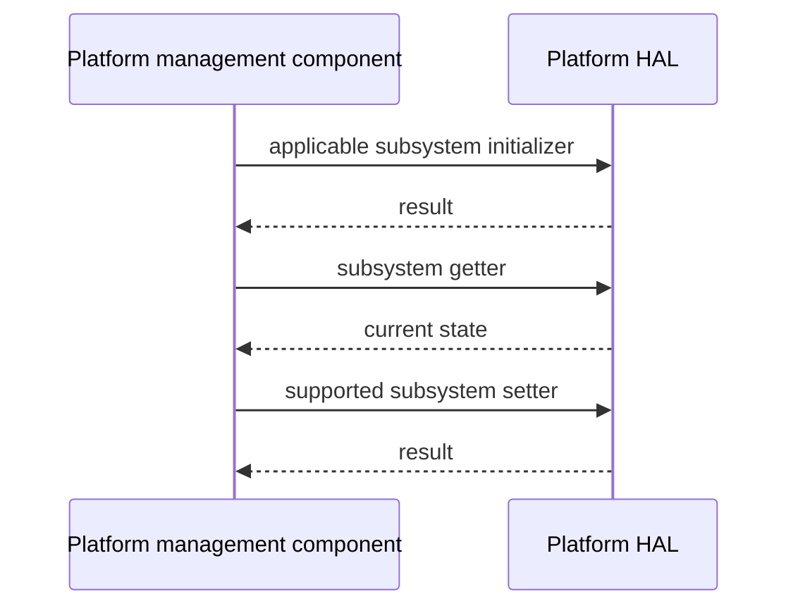

# Platform HAL Specification

## Version History

| Date | Comment | Version |
| --- | --- | --- |
| — | Documentation alignment; no ABI change. | — |

## Acronyms
HAL means Hardware Abstraction Layer; LED means Light Emitting Diode; QoS means Quality of Service; DSCP means Differentiated Services Code Point.

## Description
The platform management component uses this HAL for device identity, management access, memory and firmware information, thermal/fan/LED control, network options, security integration, and platform configuration.

## Optional Components
LED-manager, thermal-manager, MACsec, and other product feature gates affect the compiled interface. Do not assume every declaration is implemented on every device.

## Component Runtime Execution Requirements
### Initialization and Startup
Initialize the relevant subsystems independently using `platform_hal_PandMDBInit`, `platform_hal_DocsisParamsDBInit`, or `platform_hal_initThermal`. Use `platform_hal_initLed` before LED control.
### Threading Model
Serialize shared control operations unless the vendor guarantees concurrency.
### Process Model
Use the library in process and coordinate other platform configuration writers.
### Memory Model
Callers own supplied storage unless an individual declaration explicitly states otherwise. Respect per-function buffer capacities and pointer ownership.
### Power Management Requirements
Use `platform_hal_SetLowPowerModeState` for low-power control.
### Internal Error Handling
Check each function's declared result. Access-control, thermal, security, and QoS changes can affect service and management reachability.
### Persistence Model
Durability and rollback depend on each operation and product implementation.

## Nonfunctional Requirements
### Logging and Debugging
Implementations must not log credentials, secrets, security-sensitive information, or other sensitive data. Log operation outcomes rather than payloads.
### Quality Control
Use warning-clean builds, static analysis, memory checks, and safe restoration of access/security/thermal configuration.
### Licensing
See repository Apache-2.0 notices.
### Build Requirements
Compile against the public header and product implementation; legacy packaging names `libhal_platform.so`.
### Variability Management
Respect the actual LED/thermal-manager and other compile-time gates. Enum presence alone does not prove runtime support.

## Interface API Documentation
The linked header supplies exact arguments, directions, field units, capacities, and return values.

| Area | Public operations |
| --- | --- |
| Device configuration | `platform_hal_GetDeviceConfigStatus`, `platform_hal_PandMDBInit`, `platform_hal_DocsisParamsDBInit` |
| Management access | `platform_hal_GetTelnetEnable`, `platform_hal_SetTelnetEnable`, `platform_hal_GetSSHEnable`, `platform_hal_SetSSHEnable`, `platform_hal_GetSNMPEnable`, `platform_hal_SetSNMPEnable`, `platform_hal_GetWebUITimeout`, `platform_hal_SetWebUITimeout`, `platform_hal_GetWebAccessLevel`, `platform_hal_SetWebAccessLevel` |
| Identity | `platform_hal_GetModelName`, `platform_hal_GetRouterRegion`, `platform_hal_GetSerialNumber`, `platform_hal_GetHardwareVersion`, `platform_hal_GetSoftwareVersion`, `platform_hal_GetBootloaderVersion`, `platform_hal_GetFirmwareName`, `platform_hal_GetBaseMacAddress`, `platform_hal_GetHardware` |
| Memory | `platform_hal_GetHardware_MemUsed`, `platform_hal_GetHardware_MemFree`, `platform_hal_GetTotalMemorySize`, `platform_hal_GetUsedMemorySize`, `platform_hal_GetFreeMemorySize`, `platform_hal_GetMemoryPaths` |
| Reset/time/image | `platform_hal_GetFactoryResetCount`, `platform_hal_ClearResetCount`, `platform_hal_getTimeOffSet`, `platform_hal_SetDeviceCodeImageTimeout`, `platform_hal_SetDeviceCodeImageValid` |
| Factory configuration | `platform_hal_getFactoryPartnerId`, `platform_hal_getFactoryCmVariant`, `platform_hal_setFactoryCmVariant` |
| LEDs | `platform_hal_initLed`, `platform_hal_setLed`, `platform_hal_getLed` |
| Thermal/fans | `platform_hal_getFanSpeed`, `platform_hal_getRPM`, `platform_hal_getRotorLock`, `platform_hal_getFanStatus`, `platform_hal_setFanMaxOverride`, `platform_hal_initThermal`, `platform_hal_LoadThermalConfig`, `platform_hal_setFanSpeed`, `platform_hal_getFanTemperature`, `platform_hal_getInputCurrent`, `platform_hal_getInputPower`, `platform_hal_getRadioTemperature`, `platform_hal_getEcoModeStatus` |
| Security | `platform_hal_SetSNMPOnboardRebootEnable`, `platform_hal_GetMACsecEnable`, `platform_hal_SetMACsecEnable`, `platform_hal_GetMACsecOperationalStatus`, `platform_hal_StartMACsec`, `platform_hal_StopMACsec` |
| Network | `platform_hal_GetDhcpv4_Options`, `platform_hal_GetDhcpv6_Options`, `platform_hal_getCMTSMac`, `platform_hal_GetInterfaceStats`, `platform_hal_GetPppUserName`, `platform_hal_GetPppPassword` |
| Power/QoS | `platform_hal_SetLowPowerModeState`, `platform_hal_setDscp`, `platform_hal_resetDscpCounts`, `platform_hal_getDscpClientList`, `platform_hal_qos_apply` |
| Hardware/firmware | `platform_hal_GetCPUSpeed`, `platform_hal_GetFirmwareBankInfo` |

### Theory of Operation and Key Concepts
Initialize the relevant subsystem, query current state, change only intended fields, and verify the observable result. Do not turn off the sole management path during remote tests.

### Sequence Diagram

## Source References
- [platform_hal.h](https://github.com/rdkcentral/rdkb-halif-platform/blob/develop/include/platform_hal.h)
